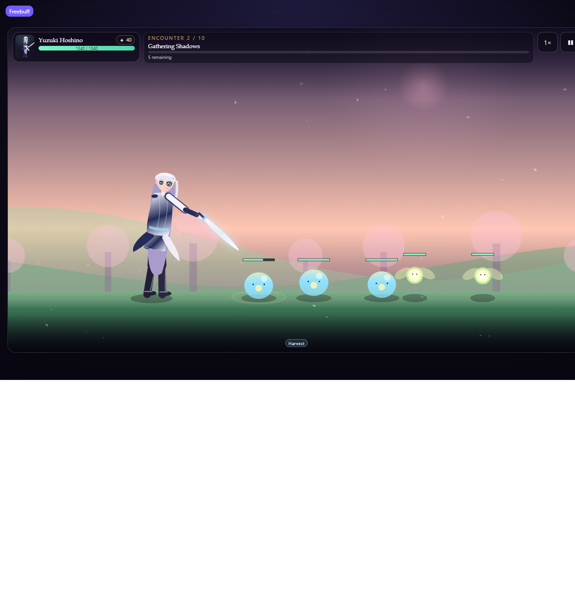
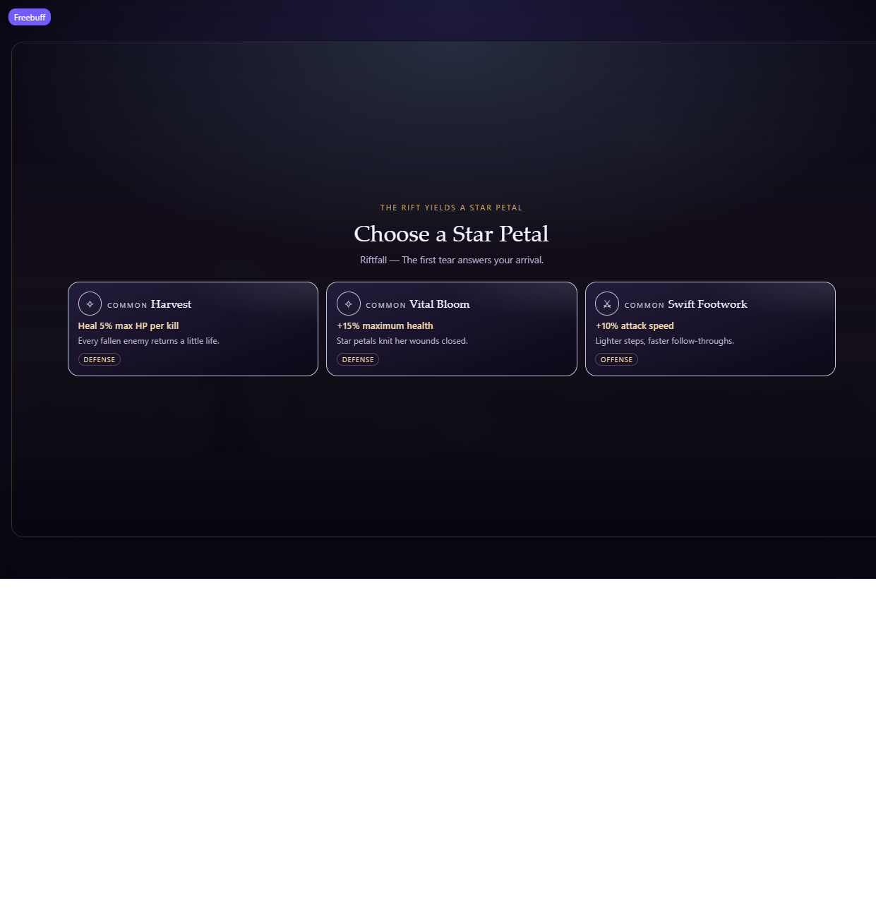
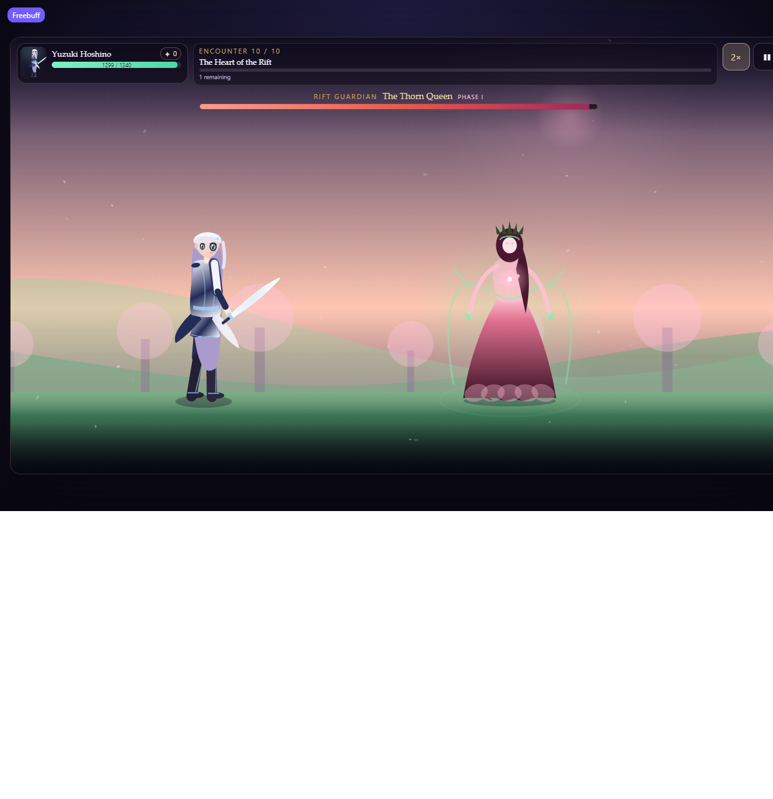
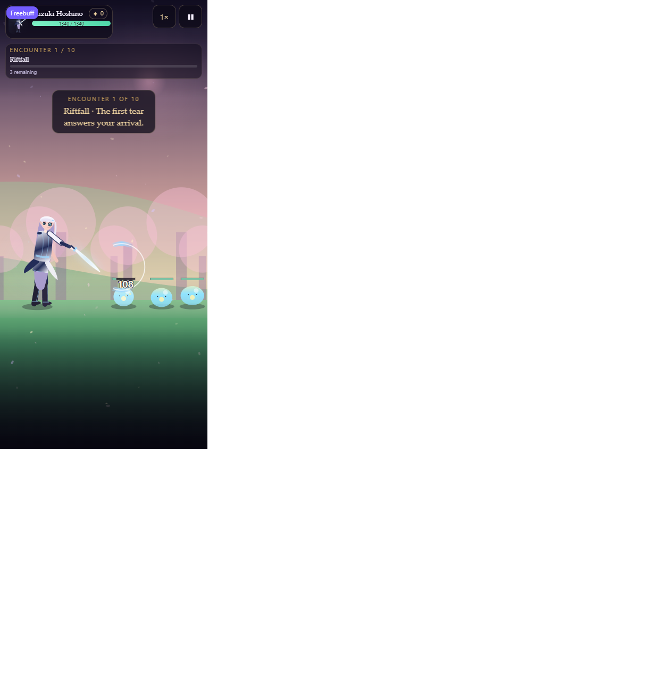
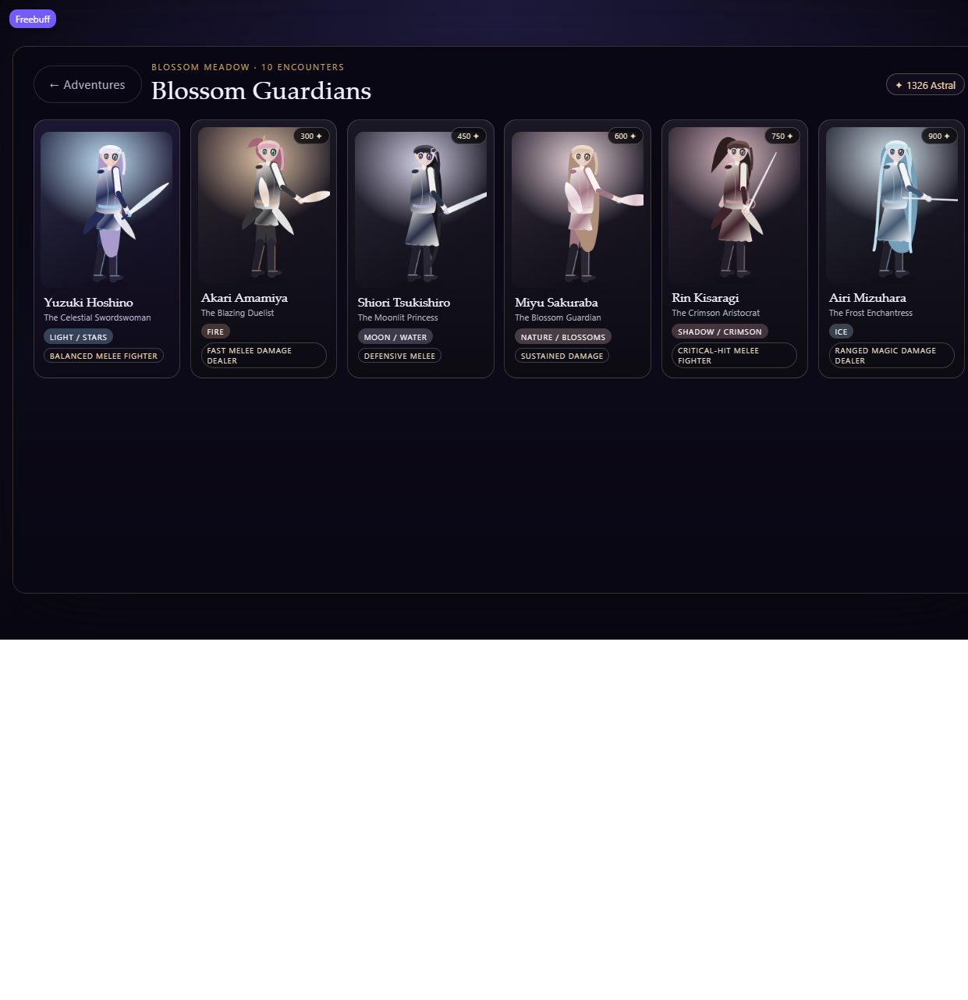
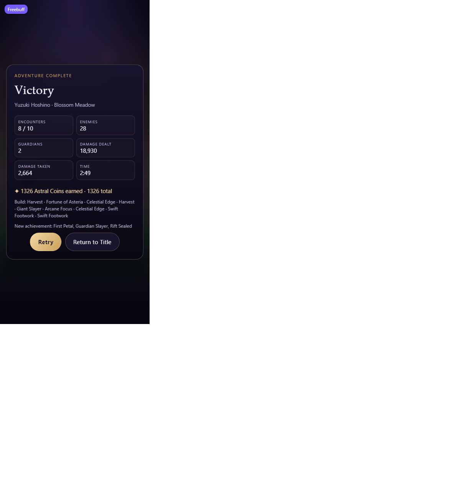
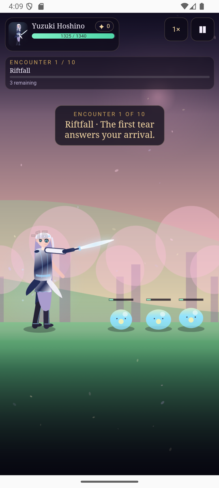
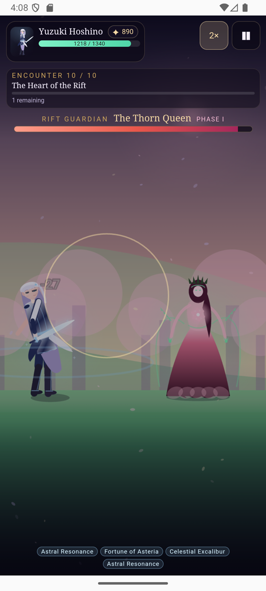
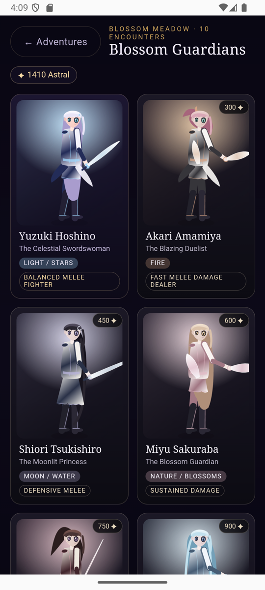
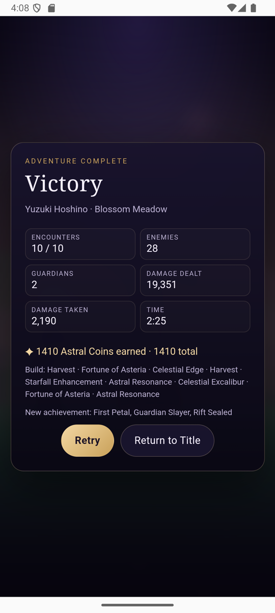

# Hoshi no Hanabira: Isekai Bloom

**星の花びら — Petals of the Stars**

An anime-inspired, side-view **auto-battler roguelite** set in the colorful isekai world of Asteria.
Choose a Blossom Guardian, watch her fight on her own, and shape her build with the Star Petals you
choose between encounters.

> **Status: playable browser build + Android debug build — 2026-11-22**
>
> The repository contains a complete run: six original heroines, five data-driven worlds,
> ten-encounter adventures, independent group enemies, solo mini-bosses and final bosses, 48
> upgrades with rarity/stacking/evolutions, Astral Coins, meta upgrades, achievements, a versioned
> save and a portrait-first interface.
>
> A **Capacitor Android debug APK** is built and was played to victory on an Android 16 emulator —
> real touch navigation, both solo bosses, upgrades, results and save persistence. It has **not**
> been tested on a physical phone, and **no iOS build exists**. The art is an original procedural
> vector rig, not painted production artwork; audio is synthesized; performance has not been
> profiled on device hardware. Those limits are spelled out below and in
> [docs/PLATFORM_COMPATIBILITY.md](docs/PLATFORM_COMPATIBILITY.md).

## Screenshots

| Desktop battle | Upgrade choice |
| --- | --- |
|  |  |

| Final boss (solo) | Phone battle (portrait) |
| --- | --- |
|  |  |

| Roster | Results |
| --- | --- |
|  |  |

| Android battle (emulator) | Android final boss (emulator) |
| --- | --- |
|  |  |

| Android roster | Android victory |
| --- | --- |
|  |  |

Screenshots were captured from the local build on 2026-11-22. The phone browser images are **viewport
emulation at 390 × 844 CSS px**; the Android images are from a **1080 × 2400 Android 16 emulator**,
not a physical phone.

## What is playable

### Encounter-based auto-battle

- The heroine holds a fixed anchor on the **left**; enemies occupy the **right**. The camera never
  scrolls and she never chases anyone.
- Combat is fully automatic. The player makes no movement, aiming or attack input during a fight.
- **Group encounters** spawn 3–8 independent enemies. Every enemy owns its health, defence, attack
  timing, status and death state.
- **Mini-boss and final-boss encounters are always solo.** `World.spawnEncounter` hard-slices the
  roster to one entity, and boss phases never summon adds.
- Single-target basics, melee arcs, piercing waves, projectile volleys, falling-star rains and area
  bursts all resolve through real simulation logic.
- Damage is applied from animation-clip events (`impact`, `projectile`, `rain`, `aoe`, `buff`, `heal`,
  `shield`) at the event's exact timestamp, so combat is not "animation theatre".

### Heroines and animation

Six adult heroines are implemented with distinct palettes, weapons, hair, outfits, stats and kits:

| Heroine | Role | Weapon | Element |
| --- | --- | --- | --- |
| Yuzuki Hoshino | Balanced melee | Celestial katana | Light / Stars |
| Akari Amamiya | Fast melee burst | Twin flame blades | Fire |
| Shiori Tsukishiro | Defensive hybrid | Moonlight longsword | Moon / Water |
| Miyu Sakuraba | Sustained damage / healing | Twin petal blades | Nature |
| Rin Kisaragi | Critical melee | Crimson rapier | Shadow |
| Airi Mizuhara | Ranged magic | Frost staff | Ice |

Every heroine shares one skeletal canvas rig but has her own pose clips for idle, basic attacks,
abilities, casting, hurt, heal/buff, ultimate, victory and defeat. Hair, skirt, weapon and breathing
are animated procedurally. The full technique is documented in
[docs/ANIMATION_GUIDELINES.md](docs/ANIMATION_GUIDELINES.md).

**Honest note:** this is an original vector/rigged look, not hand-painted anime production art. It
keeps every character anatomically and chromatically consistent across portrait, battle, roster and
results, but it is intentionally stylized and still has rough edges.

### Roguelite progression

- Ten-encounter adventures per world, including **two non-combat events** (encounters 3 and 8), a
  **solo mini-boss at 5** and a **solo final boss at 10**.
- Three upgrade cards after every reward. Offers are rarity-weighted by depth, character cards only
  appear for that heroine, stacks respect their caps, and a ready evolution is guaranteed a slot.
- 48 upgrades across offense, defence, magic, special and heroine pools; five rarity tiers; stacking
  and six pair evolutions.
- **Astral Coins** are awarded for encounters, events, bosses and achievements.
- A save writes unlocks, coins, permanent upgrades, achievements, best encounter and settings to
  versioned `localStorage` data. Corrupt saves fall back safely.
- Five worlds: Blossom Meadow (unlocked), Moonlit Forest, Crystal Kingdom, Ember Highlands and
  Celestial Ruins. Each world reuses the encounter structure with its own enemy line-up, scaling,
  palette, motif and bosses.

### Interface and speed

- Portrait-first DOM interface over a responsive Canvas arena: title, world select, six-hero roster
  and detail, upgrade cards, battle HUD, boss bar, pause, results and the Starlit Sanctum meta shop.
- Safe-area padding, 44 px minimum primary controls, stacked upgrade cards on narrow screens and a
  compact encounter row on phones.
- **1× / 2×** changes the entire simulation (attacks, cooldowns, projectiles, statuses, movement,
  animation events). Pause freezes the simulation, not just the draw loop.
- Keyboard: `Esc`/`P` pause, `T` speed. Mouse and touch use the same DOM controls.

## Getting started

Requirements: **Node.js 18+** (Bun also works) and a modern browser.

```bash
npm install
npm run dev          # Vite, http://localhost:5173

npm run typecheck    # strict TypeScript, no emit
npm test             # 54 Vitest tests
npm run build        # type check + production static bundle in dist/
npm run simulate     # headless balance runs for all six heroines
```

The production build is static HTML/CSS/JS and can be served from any static host. No environment
variables, accounts, API keys or external services are required.

### Android debug build

The native shell loads the same `dist/` bundle, so gameplay and save rules are shared.

Requirements: JDK 21, Android SDK 36, and an emulator or USB-debugging device.

```bash
npm run android:apk    # build web + cap sync + Gradle assembleDebug
adb install -r android/app/build/outputs/apk/debug/app-debug.apk
adb shell am start -n com.ayirus.hoshinohanabira/.MainActivity
```

The APK lands in `android/app/build/outputs/apk/debug/`. It is a **debug** build (no release signing).
On Windows, set `JAVA_HOME` to the Android Studio JBR or another JDK 21 and `ANDROID_HOME` to the SDK.
The verified emulator details and caveats are in
[docs/PLATFORM_COMPATIBILITY.md](docs/PLATFORM_COMPATIBILITY.md).

### How to play

1. **Begin Adventure** → choose a world → choose a heroine → **Fight with …**.
2. Watch the automatic battle. When a Star Petal drops, pick one of three upgrades.
3. Use the **1×** button to toggle simulation speed; the pause button freezes the fight.
4. A run ends at the final boss or at defeat. Results record encounters cleared, enemies, guardians,
   damage, time, coins and the build.
5. Spend Astral Coins in the Starlit Sanctum on permanent stat bonuses. New heroines and worlds are
   unlocked with coins from the roster and world screens.

## Technical overview

- **TypeScript (strict) + Vite**, **Canvas 2D** for the arena, **DOM/CSS** for the interface.
- No web runtime dependencies. The optional Android shell uses Capacitor 8 and the same bundle.
- One `SimulationClock` feeds every gameplay timer; a fixed-step simulation order keeps systems
  independent from rendering.
- Data-driven heroines, worlds, encounters and upgrades in `src/data/`.
- The world is DOM-free and testable in Node.

See [docs/ARCHITECTURE.md](docs/ARCHITECTURE.md) for the system map, [docs/GAME_DESIGN.md](docs/GAME_DESIGN.md)
for the design and [docs/DEVLOG.md](docs/DEVLOG.md) for the build record.

## Tested platforms and compatibility

| Target | Status | Evidence / limitation |
| --- | --- | --- |
| Desktop Chromium (bundled Freebuff browser), 1280 × 820 | **Tested** | Full title → world → heroine → combat → upgrades → mini-boss → final boss → victory → results flow; save persisted across reload |
| Desktop Chromium, 1440/1280-wide resized layouts | **Tested** | Layout inspected at 1280 × 820 and 390 × 844 viewports |
| Phone browser viewport (390 × 844 emulation) | **Partially tested** | Portrait HUD, group battle, upgrade cards and results inspected; touch input was not exercised on a physical device |
| Other phone sizes (narrow/wide/tablet) | **Not tested** | Responsive breakpoints exist but were not exhaustively checked |
| Firefox / Safari / Edge | **Not tested** | No compatibility claims |
| Android 16 emulator (API 36, 1080 × 2400) | **Tested (emulator)** | Debug APK installed; full 10/10 victory; real touch menus/speed/pause/first upgrade, later upgrades auto-picked; solo bosses; save survived force-stop/relaunch |
| Physical Android phone/tablet | **Not tested** | No device attached; notches, gestures and real performance unverified |
| iOS / iPadOS build | **Blocked** | No macOS/Xcode, signing certificate, provisioning profile or device; no IPA produced |
| Performance / 60 FPS / batteries | **Not measured** | The canvas loop is lightweight, but no frame-time, thermal or device measurements exist |

Two builds exist: the static browser bundle and a debug Android APK. **Do not interpret browser
viewport emulation or the Android emulator as physical-device, iOS or performance support.** Full
evidence and untested configurations are recorded in
[docs/PLATFORM_COMPATIBILITY.md](docs/PLATFORM_COMPATIBILITY.md).

## Original assets

All character, boss, background and effect visuals are drawn at runtime from original code in this
repository. There are no third-party anime images, sprites, fonts, music or sound files. Audio is
synthesized with the Web Audio API. Full notes and licensing status:
[docs/ASSET_CREDITS.md](docs/ASSET_CREDITS.md).

No software license has been granted; the repository is source-available, not open source.

## Repository layout

```text
.
├── index.html
├── src/
│   ├── main.ts              boot, save wiring, frame loop, keyboard
│   ├── core/                simulation clock and seeded RNG
│   ├── data/                heroines, enemies, worlds, upgrades
│   ├── game/                world, heroine, enemy AI, animation, combat, save
│   ├── render/              canvas rig, bosses, backgrounds, effects, camera
│   ├── audio/               synthesized sound board
│   └── ui/                  screens and HUD
├── tests/                   clock, combat, targeting, hero, simulation, upgrades
├── scripts/                 balance harness and cross-platform APK build
├── android/                 Capacitor Android project (portrait-locked)
├── resources/icon-only.png  original launcher icon source
├── docs/                    architecture, design, animation, platform, devlog
└── .github/                 pull-request template
```

## Known limitations

- The heroine rig is procedural and stylized. It is not equivalent to bespoke painted key art or
  frame-by-frame animation, and some poses/silhouettes still look stiff.
- Enemies use simple procedural archetypes. Group formations can overlap on very narrow screens.
- Audio is a small synthesized cue set; there is no music track.
- The Android APK has only been run on a **1080 × 2400 Android 16 emulator**, not a physical phone.
  The emulator needed a windowed host-GPU configuration to composite canvas layers; see the platform
  document before treating a headless screenshot as evidence.
- There is **no iOS build**: this Windows host has no Xcode, signing certificate or provisioning
  profile. No iPad or iPhone behavior is verified.
- Performance, memory, thermals and battery life are unmeasured; no minimum device requirement is
  claimed.
- There is no cloud save, account system or cross-device synchronization. Saves are local to one
  browser profile or app install (verified to survive app restart on the emulator).
- Balance is tuned from headless auto-runs plus browser and Android victories; it is not a
  statistically balanced roguelite yet.
- The project does not yet have a software license, so it must not be presented as open source.

## Credits

Design, code, procedural characters, bosses and effects: original work for this project. See
[ASSET_CREDITS.md](docs/ASSET_CREDITS.md).
