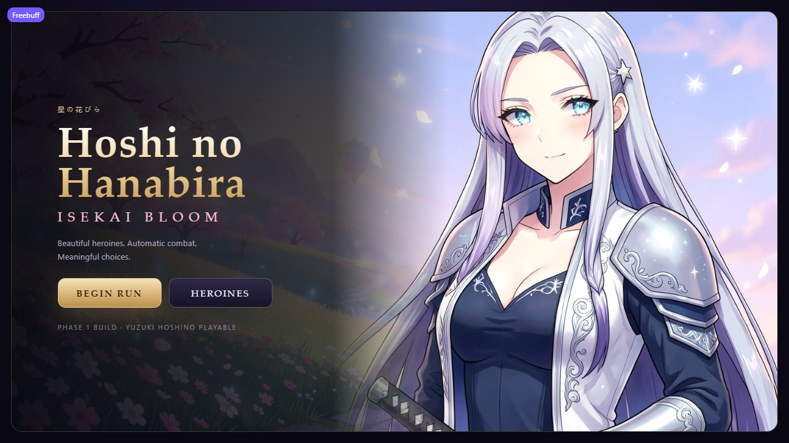
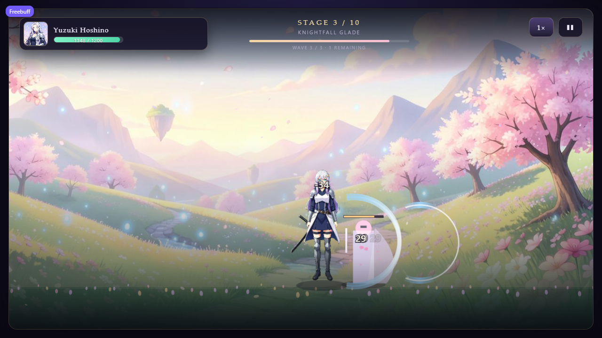
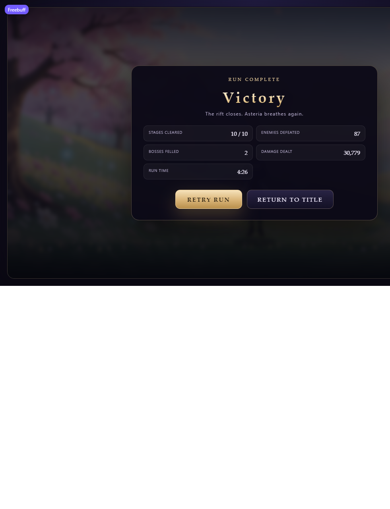

# Hoshi no Hanabira: Isekai Bloom

**星の花びら — Petals of the Stars**

An anime-inspired 2D auto-combat roguelite set in the colorful isekai world of Asteria. Choose a
Blossom Guardian, watch her fight on her own, and shape her build with the upgrades you pick between
stages.

> **Status: In Development — Phase 1 complete, prototype playable**
> The current build is a complete run with Yuzuki Hoshino in the Blossom Meadow: autonomous combat,
> ten stages, elites, the Thorn Queen boss, the 1× / 2× simulation-speed control and a results
> screen. Phase 2 (the three-choice upgrade system) is next, followed by the other five heroines,
> more worlds and permanent progression — see [`docs/ROADMAP.md`](docs/ROADMAP.md).

## Screenshots

| Title screen | Combat | Victory |
| --- | --- | --- |
|  |  |  |

Both images are captured from the current build running locally.

---

## The idea

Asteria was guarded by the Starflower Goddess, who scattered her power across the land as Star
Petals. Dimensional rifts have begun tearing open, spilling corrupted creatures into the meadows and
forests. The **Blossom Guardians** — warriors bound to the petals — travel between regions to seal
the rifts and restore the world's celestial energy.

The game is built around four ideas:

- **Beautiful anime heroines** with distinct silhouettes, weapons, elements and combat identities.
- **Automatic combat** — the heroine moves, targets and fights without manual input.
- **Meaningful upgrade decisions** made between fights.
- **Satisfying progression** through stages, bosses and (planned) permanent unlocks.

## Gameplay features

### Implemented in the current build

- **Autonomous heroine combat** — a state-based AI handles idle, target acquisition, approach,
  attacking, casting, repositioning and defeat.
- **Threat-weighted target selection** with hysteresis, so the heroine commits to a target instead
  of oscillating between two enemies.
- **Yuzuki Hoshino**, a celestial swordswoman with a katana, a dash, a crescent wave, a starfall
  rain and a self-empower, all fired automatically by condition and cooldown.
- **Enemy roster** — star slimes, forest sprites, shadow bunnies, mushroomlings, crystal beetles,
  flame spirits, plus elite fairy knights, shadow wolves and an arcane guardian.
- **Ten-stage run** with escalating waves and stat scaling, closing on the Thorn Queen boss with
  summons, telegraphs and a second phase.
- **1× / 2× simulation speed** driven by one central clock, plus pause. The toggle is a real
  simulation multiplier: movement, cooldowns, projectiles, damage-over-time, spawns and stage timers
  all read the same simulated delta.
- **Main menu, heroine roster, pause menu and run results** (stages cleared, enemies defeated,
  bosses felled, damage dealt, run duration).
- **Synthesised audio and visual feedback** — sword trails, impact particles, floating damage
  numbers, critical indicators and stage banners.

### Planned

- Three-choice upgrade cards with rarity, stacking, evolutions and per-heroine pools (Phase 2).
- Painted sprites for the remaining enemies and heroines, replacing procedural art (Phase 3/6).
- Akari, Shiori, Miyu, Rin and Airi as fully playable heroines (Phase 3).
- Moonlit Forest, Crystal Kingdom, Ember Highlands and Celestial Ruins worlds (Phase 4).
- Astral Coins, permanent upgrades, unlocks, achievements and save persistence (Phase 5).
- Extended animation, audio and UI polish (Phase 6).

## Tech stack

- **TypeScript** (strict) with **Vite** for development and builds.
- **HTML5 Canvas 2D** for the world renderer; the interface is plain DOM + CSS.
- **Vitest** for unit tests of the pure simulation systems.
- No runtime dependencies; no external services, accounts or trackers.

## Getting started

Requirements: **Node.js 18+** (or **Bun 1.1+**) and a modern browser.

```bash
# install dependencies
npm install

# start the dev server (http://localhost:5173)
npm run dev

# strict type check + production build
npm run build

# run the unit tests
npm test
```

`npm` can be replaced with `bun` if you prefer. The production bundle is emitted to `dist/` and can
be served by any static file host.

## How to play

1. **Begin Run** from the title screen.
2. Watch Yuzuki fight. Combat is fully automatic — no movement or attack input.
3. Use the **1× / 2×** button (or `T`) to change simulation speed.
4. Press **Esc** (or `P`) to pause, restart or quit.
5. A run ends when the Thorn Queen falls, or when Yuzuki does.

## Project structure

```text
hoshi-no-hanabira/
├── index.html               # canvas + interface shell
├── src/
│   ├── main.ts              # boot, screen wiring, frame loop
│   ├── style.css            # interface styling
│   ├── core/                # simulation clock, RNG, small utilities
│   ├── data/                # data-driven heroines, enemies and stages
│   ├── game/                # world simulation, hero AI, enemy AI, spawning
│   ├── render/              # canvas renderer, sprites, effects, background
│   ├── audio/               # synthesised sound effects
│   └── ui/                  # screens, HUD and bindings
├── assets/                  # original generated art (see ASSET_CREDITS)
├── tests/                   # Vitest suites for simulation systems
└── docs/                    # design, roadmap, architecture, devlog
```

## Documentation

- [Game design](docs/GAME_DESIGN.md) — world, heroines, enemies, run structure.
- [Roadmap](docs/ROADMAP.md) — phases, status and acceptance criteria.
- [Architecture](docs/ARCHITECTURE.md) — systems, simulation clock, AI and data flow.
- [Development log](docs/DEVLOG.md) — chronological record of the build.
- [Changelog](CHANGELOG.md) — user-visible changes per version.
- [Contributing](CONTRIBUTING.md) — branch, commit and pull-request workflow.

## Credits

Art is original, generated for this project; the soundtrack is absent and all sound effects are
synthesised at runtime with the Web Audio API. See [`docs/ASSET_CREDITS.md`](docs/ASSET_CREDITS.md)
for details and licensing notes.

No third-party anime artwork, characters, logos or music are used or redistributed.
